<div align="center">



<br><br>


<br>

<a href="https://github.com/deadcow-ghw">
  
</a>
<a href="https://hippolytedev.ru">
  
</a>
<a href="https://discord.gg/cdcleak">
  
</a>

</div>

<br>


## `STAGE 01 // WHOAMI`

<div align="center">



</div>

```text
> [PLAYER_01] Hippolyte (deadcow.ghw) - Dev Full-Stack & Pentester Ethique (France)
> [BUILD]     Apps web, desktop et Android, outils secu, scripts et services auto-heberges.
> [OFFSEC]    Pentest web/API (XSS, SQLi, IDOR, auth/RBAC), OSINT/CSINT et hardening Linux/VPS.
> [INFRA]     Linux, Docker, Proxmox VE, Nginx, Cloudflare, Tor et Pterodactyl.
> [GUILD]     Fondateur de CDCLEAK (dev, tech et cybersecurite).
```

<br>


## `STAGE 02 // STACK & SKILLS`

<div align="center">



</div>

<br>

<div align="center">

| `MODULE` | `TECHNOLOGIES` |
| :--- | :--- |
| **`01 // Langages & Scripting`** |  |
| **`02 // Frameworks & Runtime`** |  |
| **`03 // Infra & Self-Hosting`** |  |
| **`04 // Bases de Donnees`** |  |
| **`05 // Cybersecurite & OSINT`** |       |

</div>

<br>


## `STAGE 03 // PROJECTS`

<div align="center">



</div>

<br>

<div align="center">

| `SLOT` | `DESCRIPTION` | `LINK` |
| :--- | :--- | :---: |
| **`[01] Deadcow-App`** | Boite a outils Android RF / IR-Storm / BLE / NFC et audit materiel sans root (GPLv3) | [](https://github.com/deadcow-ghw/Deadcow-App) |
| **`[02] Deadcord`** | Client Discord durci : Tor par defaut (Fail-Closed), multi-comptes isole, E2EE AES-256 et Vencord | [](https://github.com/deadcow-ghw/Deadcord) |
| **`[03] Deadcow-Store`** | Portail et gestionnaire de paquets signe SHA-256 pour les apps Deadcow (Android & Desktop) | [](https://github.com/deadcow-ghw/Deadcow-Store) |
| **`[04] CDC LEARN`** | 260 cours cybersecurite & dev, labs Docker et challenges CTF | [](https://learn.cdcleak.lol/) |
| **`[05] CDC Mail`** | Webmail PGP et adresses temporaires anti-spam, sans logs IP et conforme RGPD | [](https://mail.cdcleak.lol/) |
| **`[06] Portfolio`** | Site Astro : projets, stack, audits secu et telemetrie serveur | [](https://hippolytedev.ru/) |

</div>

<br>


## `STAGE 04 // CONTRIBUTIONS`

<div align="center">

<picture>
  <source media="(prefers-color-scheme: dark)" srcset="https://raw.githubusercontent.com/deadcow-ghw/deadcow-ghw/output/pacman-contribution-graph-dark.svg" />
  <source media="(prefers-color-scheme: light)" srcset="https://raw.githubusercontent.com/deadcow-ghw/deadcow-ghw/output/pacman-contribution-graph.svg" />
  
</picture>

</div>

<br>


## `STAGE 05 // STATS`

<div align="center">


<br><br>


<br><br>


</div>

<br>


## `CONNECT`

<div align="center">

<a href="https://hippolytedev.ru">
  
</a>
<a href="https://discord.gg/cdcleak">
  
</a>
<a href="mailto:ghw@cdcleak.lol">
  
</a>
<a href="https://www.tiktok.com/@deadcowghw">
  
</a>

<br><br>



</div>
